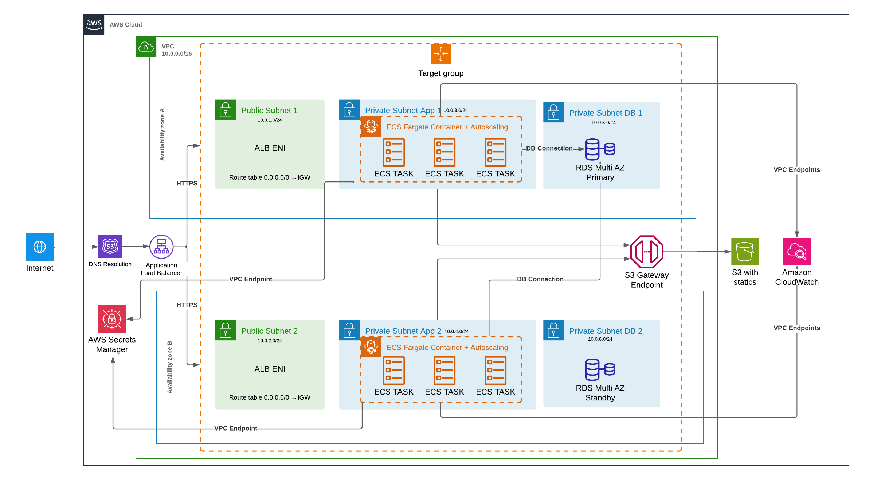

# AWS Django App

AWS Cloud | Terraform Infrastructure | Django 5.0.7 | Docker Containerized | PostgreSQL Database

Enterprise-grade Django application deployed on AWS with complete CI/CD pipeline, advanced security, and global content delivery.

## Overview

This project demonstrates enterprise-level DevOps practices by implementing a Django application with complete AWS cloud infrastructure, automated CI/CD pipeline, and advanced security configurations. The application showcases modern cloud-native architecture patterns including containerization, microservices deployment, global content delivery, and infrastructure as code.

**Live Application**: https://app-django.samuellincoln.com

**Repository**: https://bitbucket.org/samuellincoln/testedevops

## Architecture



### Architecture Overview

The application follows a **multi-tier, highly available architecture** deployed across multiple AWS availability zones:

- **Presentation Layer**: CloudFront CDN + WAF
- **Application Layer**: ECS Fargate containers behind ALB
- **Data Layer**: Multi-AZ RDS PostgreSQL
- **Storage Layer**: S3 for static files
- **Security Layer**: WAF, Secrets Manager, VPC with private subnets

## Features

### Application Features
- CRUD Operations - Complete Create, Read, Update, Delete functionality
- Real-time Feedback - Instant status updates for all operations
- Database Integration - PostgreSQL with timestamps tracking

### Infrastructure Features
- Auto Scaling - Intelligent CPU-based scaling (2-6 containers)
- High Availability - Multi-AZ deployment across 2 availability zones
- Global CDN - CloudFront for worldwide content delivery
- Advanced Security - WAF with multiple protection layers
- Comprehensive Monitoring - CloudWatch logs and metrics

## Technology Stack

### Backend
- **Django 5.0.7** - Python web framework
- **PostgreSQL 15** - Primary database
- **Gunicorn** - WSGI HTTP Server
- **Python 3.12** - Runtime environment

### Infrastructure
- **AWS ECS Fargate** - Container orchestration
- **AWS RDS** - Managed database service
- **AWS S3** - Object storage
- **AWS CloudFront** - Content Delivery Network
- **AWS ALB** - Application Load Balancer
- **AWS WAF** - Web Application Firewall

### DevOps & Tools
- **Terraform** - Infrastructure as Code
- **Docker** - Containerization
- **AWS CodePipeline** - CI/CD automation
- **AWS CodeBuild** - Build service
- **Bitbucket** - Source code management

## Infrastructure Components

### Compute Resources
- **ECS Cluster**: django-app-cluster
- **ECS Service**: django-app-service
- **Task Definition**: 2048 CPU, 4096 MB Memory
- **Auto Scaling**: 2-6 tasks based on CPU utilization (70% target)

### Database
- **Engine**: PostgreSQL 15
- **Instance**: db.t3.micro
- **Storage**: 20GB (auto-scaling to 100GB)
- **Backup**: Automated with 7-day retention
- **Monitoring**: Performance Insights enabled

## Security Features

### Network Security
- **Private Subnets** - Application and database in private subnets
- **Security Groups** - Restrictive ingress/egress rules
- **VPC Endpoints** - Private communication with AWS services
- **NAT Gateways** - Secure internet access for private resources

### Application Security
- **AWS WAF** - Web Application Firewall with:
  - Rate limiting (2000 requests/minute per IP)
  - SQL injection protection
  - Geographic blocking (China, Russia, North Korea)
  - Common attack pattern detection
- **SSL/TLS** - End-to-end encryption
- **Secrets Manager** - Secure credential storage
- **IAM Roles** - Least privilege access

### Data Security
- **Encryption at Rest** - RDS and S3 encryption
- **Encryption in Transit** - HTTPS/TLS everywhere
- **Database Security** - Private subnet, restricted access
- **Backup Encryption** - Automated encrypted backups

## CI/CD Pipeline

### Pipeline Stages
Source (Bitbucket) -> Build (CodeBuild) -> Deploy (ECS)

### Automated Process
1. **Trigger**: Commit to main branch
2. **Source**: Download code from Bitbucket
3. **Build**: 
   - Docker image build
   - Push to ECR with commit hash tag
   - Update latest tag
4. **Deploy**: 
   - Update ECS service
   - Zero-downtime rolling deployment

### Build Specifications
- **Environment**: Amazon Linux 2
- **Runtime**: Docker-in-Docker
- **Build Time**: ~5-8 minutes
- **Artifacts**: Container images in ECR

## Scalability & High Availability

### Auto Scaling Configuration
- **Metric**: CPU Utilization
- **Target**: 70% average CPU
- **Scale Out**: Add tasks when CPU > 70%
- **Scale In**: Remove tasks when CPU < 63%
- **Cooldown**: 5 minutes between scaling actions

### High Availability Features
- **Multi-AZ Deployment** - Resources across 2 availability zones
- **Load Balancing** - ALB distributes traffic across healthy tasks
- **Health Checks** - Application and infrastructure level
- **Auto Recovery** - Automatic task replacement on failure
- **Database Failover** - RDS Multi-AZ automatic failover

## Getting Started

### Prerequisites
- AWS CLI configured
- Terraform >= 1.0
- Docker
- Git

### Quick Deploy
```bash
# Clone repository
git clone https://bitbucket.org/samuellincoln/testedevops.git
cd testedevops

# Configure infrastructure
cd infra
cp terraform.tfvars.example terraform.tfvars
# Edit terraform.tfvars with your values

# Deploy infrastructure
terraform init
terraform plan
terraform apply

# Build and push initial image
aws ecr get-login-password --region us-east-1 | docker login --username AWS --password-stdin YOUR_ACCOUNT.dkr.ecr.us-east-1.amazonaws.com
cd ../app
docker build -t django-app .
docker tag django-app:latest YOUR_ACCOUNT.dkr.ecr.us-east-1.amazonaws.com/django-app:latest
docker push YOUR_ACCOUNT.dkr.ecr.us-east-1.amazonaws.com/django-app:latest
```

## Local Development

### Setup Local Environment
```bash
# Create virtual environment
cd app
python -m venv .venv
source .venv/bin/activate  # Linux/Mac
# .venv\Scripts\activate   # Windows

# Install dependencies
pip install -r requirements.txt

# Setup environment variables
cp .env.example .env
# Edit .env with local database settings

# Run migrations
python manage.py migrate

# Start development server
python manage.py runserver
```

### Local Database Setup
```bash
# Using Docker for local PostgreSQL
docker run -d \
  --name postgres-dev \
  -e POSTGRES_DB=app \
  -e POSTGRES_USER=app \
  -e POSTGRES_PASSWORD=password \
  -p 5432:5432 \
  postgres:15
```

## Deployment


### Environment Configuration
```hcl
# terraform.tfvars
django_secret_key     = "your-secret-key"
db_password          = "your-db-password"
certificate_arn      = "your-ssl-certificate-arn"
subdomain_full_name  = "your-domain.com"
s3_bucket_name       = "your-bucket-name"
bitbucket_repo_name  = "username/repository"
```

## Monitoring & Logging

### CloudWatch Log Groups
- `/ecs/django-app-service` - Application logs
- `/aws/codebuild/django-app-build` - Build logs
- `/aws/rds/instance/postgresql` - Database logs

### Metrics & Alarms
- **ECS Service**: CPU, Memory, Task count
- **ALB**: Request count, Response time, Error rate
- **RDS**: CPU, Connections, Storage
- **Auto Scaling**: Scaling activities

### Health Checks
- **Application**: `/healthz/` endpoint
- **Load Balancer**: HTTP 200 response check
- **Container**: Docker health check

**Samuel Lincoln**
- Bitbucket: @samuellincoln
- LinkedIn: Samuel Lincoln

---

**Note**: This project was created as a technical demonstration of enterprise-level DevOps practices and AWS cloud architecture. It showcases advanced concepts including infrastructure as code, containerization, CI/CD automation, and security best practices.
