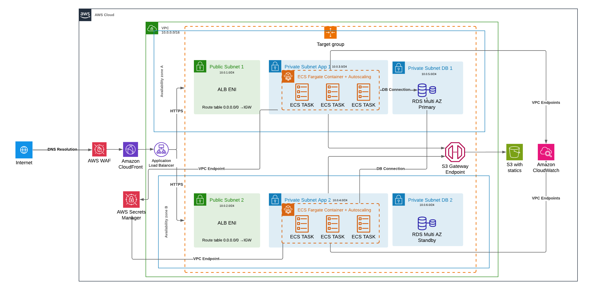

# AWS Django Platform

AWS Cloud | Terraform Infrastructure | Django 5.2 | Docker Containerized | PostgreSQL Database

Django application deployed on AWS with a complete CI/CD pipeline, layered security and content delivery through CloudFront.

## Overview

This project implements the AWS infrastructure for a containerized Django application, fully provisioned with Terraform: ECS Fargate in private subnets, Multi-AZ RDS PostgreSQL, CloudFront + WAF as the single entry point and a CodePipeline that tests, migrates and deploys every commit.

The application is a simple CRUD; the focus of the project is the infrastructure and the release process around it.

**Repository**: https://github.com/samuelincoln1/aws-django-platform

**Status**: not currently deployed, to avoid the monthly cost (~$208/month, see the [cost analysis](docs/cost-analysis.md))

## Architecture



### Architecture Overview

The application follows a multi-tier, highly available architecture deployed across two AWS availability zones:

- **Edge Layer**: CloudFront + WAF, the only entry point to the application
- **Load Balancing Layer**: ALB in public subnets, reachable only from CloudFront
- **Application Layer**: ECS Fargate tasks in private subnets with no internet route
- **Data Layer**: Multi-AZ RDS PostgreSQL in isolated private subnets
- **Storage Layer**: S3 for static files, served by CloudFront at `/static/*`

## Features

### Application Features
- CRUD Operations - Create, read, update and delete items through a JSON API
- Real-time Feedback - Status updates for every operation
- CSRF Protection - API protected by Django's CSRF token
- Test Suite - API, health check and CSRF tests run on every build

### Infrastructure Features
- Auto Scaling - CPU-based target tracking (2-6 tasks)
- High Availability - Multi-AZ deployment across 2 availability zones
- Zero-Downtime Deployments - Rolling updates with automatic rollback
- Layered Security - WAF, origin protection, private subnets, least-privilege IAM
- Monitoring - CloudWatch logs, Container Insights and RDS Performance Insights

## Technology Stack

### Backend
- **Django 5.2 LTS** - Python web framework
- **PostgreSQL 17** - Primary database
- **Gunicorn** - WSGI HTTP server
- **Python 3.12** - Runtime environment

### Infrastructure
- **AWS ECS Fargate** - Container orchestration
- **AWS RDS** - Managed PostgreSQL database
- **AWS S3** - Static files storage
- **AWS CloudFront** - Content Delivery Network
- **AWS ALB** - Application Load Balancer
- **AWS WAF** - Web Application Firewall
- **AWS Secrets Manager** - Credentials storage
- **AWS ECR** - Container registry

### DevOps & Tools
- **Terraform** - Infrastructure as Code (modular, AWS provider 6.x)
- **Docker** - Containerization
- **AWS CodePipeline** - CI/CD orchestration
- **AWS CodeBuild** - Build, test and deploy jobs
- **GitHub** - Source code management (Bitbucket and GitLab also supported)

## Infrastructure Components

### Networking
- **VPC**: 10.0.0.0/16 across 2 availability zones
- **Subnets**: public (ALB), private app (ECS) and private database (RDS) in each AZ
- **VPC Endpoints**: ECR, CloudWatch Logs, Secrets Manager (interface) and S3 (gateway)
- **NAT Gateway**: none, private subnets have no internet access

### Compute Resources
- **ECS Cluster / Service**: django-app-prod
- **Task Definition**: 1024 CPU, 2048 MB memory
- **Auto Scaling**: 2-6 tasks based on CPU utilization (70% target)

### Database
- **Engine**: PostgreSQL 17
- **Instance**: db.t3.micro, Multi-AZ
- **Storage**: 20 GB gp3 (auto-scaling to 100 GB), encrypted
- **Backup**: automated, 7-day retention, final snapshot on deletion
- **Monitoring**: Performance Insights and Enhanced Monitoring enabled

### Terraform Modules
- **vpc** - Subnets, route tables and VPC endpoints
- **alb** - Load balancer restricted to CloudFront
- **cdn** - CloudFront distribution, Origin Access Control, optional Route 53 record
- **waf** - Web ACL attached to CloudFront
- **s3** - Static files bucket
- **ecr** - Image repository with lifecycle policy
- **ecs** - Cluster, task definition, service, autoscaling and IAM roles
- **rds** - PostgreSQL instance, parameter group and monitoring
- **secrets** - Secrets Manager secrets
- **pipeline** - CodePipeline, CodeBuild projects and IAM roles

## Security Features

### Network Security
- **Private Subnets** - Application and database without any route to the internet
- **CloudFront-only Origin** - ALB accepts only CloudFront IP ranges and requests carrying a secret header
- **Security Groups** - Database reachable only from the ECS tasks' security group
- **VPC Endpoints** - Private access to AWS services, endpoint policy restricted to the required buckets

### Application Security
- **AWS WAF** - Applied to every request, with:
  - Rate limiting (2000 requests per IP every 5 minutes)
  - SQL injection protection
  - Known bad inputs and common attack patterns (AWS managed rules)
  - Geographic blocking (China, Russia, North Korea)
- **SSL/TLS** - HTTPS from the browser to CloudFront and from CloudFront to the ALB
- **Django Hardening** - HSTS, secure cookies, HTTPS redirect, `check --deploy` in CI
- **IAM Roles** - Least privilege, scoped to the specific resources

### Data Security
- **Secrets Manager** - Credentials injected into the containers at startup
- **Secrets out of Terraform State** - Ephemeral variables and write-only arguments
- **Encryption at Rest** - RDS, S3 and Secrets Manager
- **Private Static Bucket** - Readable only by CloudFront (Origin Access Control)

## CI/CD Pipeline

### Pipeline Stages
Source (GitHub) -> Build (CodeBuild) -> Deploy (CodeBuild + ECS)

### Automated Process
1. **Trigger**: Commit to the main branch
2. **Source**: Download code through an AWS CodeConnections connection
3. **Build**:
   - Docker image build
   - Test suite and Django deployment checks inside the built image
   - Push to ECR with an immutable tag (commit hash + build number)
4. **Deploy**:
   - Register a new task definition revision with the new image
   - Run migrations and collectstatic once, as a one-off ECS task
   - Update the ECS service with a zero-downtime rolling deployment
   - Automatic rollback if the new tasks fail their health checks

### Build Specifications
- **Environment**: Amazon Linux 2023 (CodeBuild standard 5.0)
- **Runtime**: Docker in privileged mode
- **Execution Mode**: queued, a release is never interrupted halfway
- **Artifacts**: Container images in ECR (last 20 kept)

## Scalability & High Availability

### Auto Scaling Configuration
- **Metric**: ECS service average CPU utilization
- **Target**: 70% average CPU
- **Capacity**: 2 to 6 tasks
- **Scale Out Cooldown**: 1 minute
- **Scale In Cooldown**: 5 minutes

### High Availability Features
- **Multi-AZ Deployment** - Resources across 2 availability zones
- **Load Balancing** - ALB distributes traffic across healthy tasks
- **Health Checks** - ALB and container level (`/healthz/`)
- **Auto Recovery** - Unhealthy tasks are replaced automatically
- **Database Failover** - RDS Multi-AZ automatic failover
- **Deployment Circuit Breaker** - Failed deployments roll back automatically

## Cost

- **Minimum (2 tasks)**: ~$208/month
- **Maximum (6 tasks)**: ~$352/month
- **Details**: [docs/cost-analysis.md](docs/cost-analysis.md), including the VPC endpoints vs NAT gateway comparison and cost reduction options

## Getting Started

### Prerequisites
- AWS CLI configured
- Terraform >= 1.11
- Docker
- Git
- A domain and an ACM certificate for it in us-east-1

### Deploy
```bash
# 1. Terraform state bucket (once)
cd infra/bootstrap
terraform init
terraform apply -var state_bucket_name=<unique-bucket-name>

# 2. Configuration
cd ..
cp backend.hcl.example backend.hcl
cp terraform.tfvars.example terraform.tfvars
export TF_VAR_django_secret_key="$(python3 -c 'import secrets; print(secrets.token_urlsafe(50))')"
export TF_VAR_db_password="$(openssl rand -base64 24 | tr -d '/@" ')"

# 3. Infrastructure
terraform init -backend-config=backend.hcl
terraform apply
```

After the apply:
- Approve the source connection in the AWS console (Developer Tools > Settings > Connections)
- Run the pipeline (Release change) to build and deploy the first image
- If Route 53 is not managed by the project, point the domain to the `cloudfront_domain_name` output

### Local Development
```bash
docker compose up                                  # http://localhost:8000
docker compose run --rm app python manage.py test
```

## Next Steps

- CloudWatch alarms and dashboards (5xx rate, latency, RDS CPU and storage)
- Terraform checks in CI (fmt, validate, tflint, plan on pull requests)
- Separate staging environment
- Automatic secret rotation
- Authentication on the API

## Author

**Samuel Lincoln**
- Portfolio: https://samuellincoln.com
- LinkedIn: https://www.linkedin.com/in/samuel-lincoln-213429209/
- GitHub: [@samuelincoln1](https://github.com/samuelincoln1)
