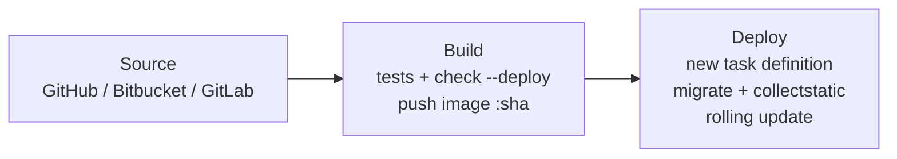

# AWS Django Platform

Production-style infrastructure for a containerized Django application on AWS,
written in Terraform: ECS Fargate in private subnets, RDS PostgreSQL Multi-AZ,
CloudFront + AWS WAF as the only entry point, and a CodePipeline that tests,
migrates and deploys every commit.

The application itself is intentionally small (a CRUD of items). The focus of
the project is the infrastructure and the release process around it.

> The environment is not kept running, to avoid its ~$208/month cost — see the
> [cost analysis](docs/cost-analysis.md).

## Architecture


| Layer | Subnets | Notes |
|---|---|---|
| Edge | — | CloudFront with WAF; static files from S3, everything else to the ALB |
| Load balancer | Public | Accepts HTTPS only from CloudFront's IP ranges, and forwards only requests carrying the CloudFront secret header |
| Application | Private (no internet route) | ECS Fargate, CPU target-tracking autoscaling from 2 to 6 tasks |
| Database | Private (no internet route) | RDS PostgreSQL 17, Multi-AZ, encrypted, reachable only from the tasks' security group |

## Design decisions

### CloudFront and WAF are the only way in

The ALB has a public DNS name, so blocking direct access takes two layers:

1. Its security group only allows the AWS-managed prefix list of CloudFront
   origin-facing IPs.
2. Its HTTPS listener returns `403` by default and only forwards requests with
   a secret `X-Origin-Verify` header that CloudFront adds. This stops someone
   from pointing their own CloudFront distribution at the ALB.

As a result, every request to the application goes through AWS WAF (AWS
managed rule groups for common exploits, known bad inputs and SQL injection,
2,000 requests per IP per 5 minutes, and geo blocking).

### Private subnets without NAT gateways

The tasks only need to talk to AWS services, so the private subnets have no
route to the internet. ECR, CloudWatch Logs and Secrets Manager are reached
through interface endpoints, and S3 through a free gateway endpoint whose
policy only allows the application bucket and the ECR layer bucket. The cost is
close to two NAT gateways, but the containers cannot reach arbitrary hosts —
see the [comparison](docs/cost-analysis.md#design-decision-vpc-endpoints-instead-of-nat-gateways).

### Immutable releases, migrations before rollout

- Images are tagged with the commit SHA (plus build number) in an ECR
  repository with immutable tags.
- Each release registers a new task definition revision, so rolling back means
  pointing the service at a previous revision.
- Migrations and `collectstatic` run **once**, as a one-off ECS task, before
  the service is updated — not in the container entrypoint, where several tasks
  starting at the same time would race.
- The rolling update keeps 100% of the capacity healthy, and the ECS
  deployment circuit breaker rolls back automatically if the new tasks fail
  their health checks.

### Secrets never reach the Terraform state

The Django `SECRET_KEY` and the database password are
[ephemeral variables](https://developer.hashicorp.com/terraform/language/values/variables#exclude-values-from-state)
sent through write-only arguments (`secret_string_wo`, `password_wo`). ECS
injects them into the container from Secrets Manager at startup. The execution
role can read only these two secrets.

### Static files on the application's own domain

`collectstatic` uploads files with content-hashed names to S3. CloudFront
serves them at `/static/*` on the same domain as the application, so there is
no CORS and no stale cache after a release. The bucket is private and readable
only by the distribution (Origin Access Control).

## CI/CD



| Stage | What happens | Defined in |
|---|---|---|
| Source | Commit on `main` through an AWS CodeConnections connection | [`infra/modules/pipeline`](infra/modules/pipeline/main.tf) |
| Build | Builds the image, runs the test suite and `manage.py check --deploy` **inside the image that will ship**, pushes it to ECR | [`ci/buildspec-build.yml`](ci/buildspec-build.yml) |
| Deploy | Registers a task definition revision with the new image, runs migrations as a one-off task, updates the service and waits for the rollout to complete or fail | [`ci/deploy.sh`](ci/deploy.sh) |

The pipeline runs in `QUEUED` mode, so a release is never superseded in the
middle of its migrations.

## Repository layout

```
app/                    Django application (Dockerfile, settings, tests)
ci/                     Buildspecs and the deploy script used by CodeBuild
docs/                   Architecture diagram and cost analysis
infra/
  bootstrap/            S3 bucket for the Terraform state (applied once)
  modules/
    vpc/                Subnets in N AZs, route tables, VPC endpoints
    alb/                Load balancer restricted to CloudFront
    cdn/                CloudFront distribution, OAC, optional Route 53 record
    waf/                Web ACL (us-east-1, CLOUDFRONT scope)
    s3/                 Static files bucket
    ecr/                Image repository and lifecycle policy
    ecs/                Cluster, task definition, service, autoscaling, IAM
    rds/                PostgreSQL, parameter group, monitoring
    secrets/            Secrets Manager secrets
    pipeline/           CodePipeline, CodeBuild projects, IAM
docker-compose.yml      Local development (Django + PostgreSQL)
```

## Running locally

```bash
docker compose up
# http://localhost:8000

docker compose run --rm app python manage.py test
```

Without Docker, copy `app/.env.example` to `app/.env` (it can point to SQLite
with `DATABASE_URL=sqlite:///db.sqlite3`), install `app/requirements.txt` in a
virtualenv and run `python manage.py migrate && python manage.py runserver`.

## Deploying

Requirements: Terraform ≥ 1.11, AWS CLI, a domain name and an ACM certificate
for it in `us-east-1` (CloudFront only accepts certificates from that region).

```bash
# 1. State bucket (once)
cd infra/bootstrap
terraform init
terraform apply -var state_bucket_name=<unique-bucket-name>

# 2. Configuration
cd ..
cp backend.hcl.example backend.hcl                # state bucket and key
cp terraform.tfvars.example terraform.tfvars      # domain, certificates, repository
export TF_VAR_django_secret_key="$(python3 -c 'import secrets; print(secrets.token_urlsafe(50))')"
export TF_VAR_db_password="$(openssl rand -base64 24 | tr -d '/@" ')"

# 3. Infrastructure
terraform init -backend-config=backend.hcl
terraform apply
```

Then:

1. Approve the source connection in the AWS console (*Developer Tools →
   Settings → Connections*) — the `source_connection_arn` output. Connections
   are created in a pending state and the first pipeline run fails until this
   is done; use *Release change* afterwards.
2. If `route53_zone_id` was not set, point the domain to the
   `cloudfront_domain_name` output.

Until the first release finishes, the ECS service has no image to run and its
tasks fail to start; this is expected.

To tear everything down, set `deletion_protection = false` in
[`infra/modules/rds`](infra/modules/rds/variables.tf) and apply before
`terraform destroy`. A final snapshot of the database is kept.

## Author

**Samuel Lincoln** — Cloud & DevOps Engineer

- Portfolio: [samuellincoln.com](https://samuellincoln.com)
- LinkedIn: [samuel-lincoln-213429209](https://www.linkedin.com/in/samuel-lincoln-213429209/)
- GitHub: [@samuelincoln1](https://github.com/samuelincoln1)
